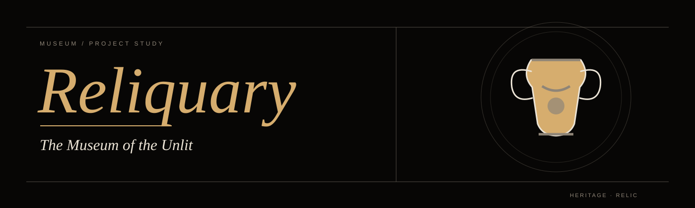
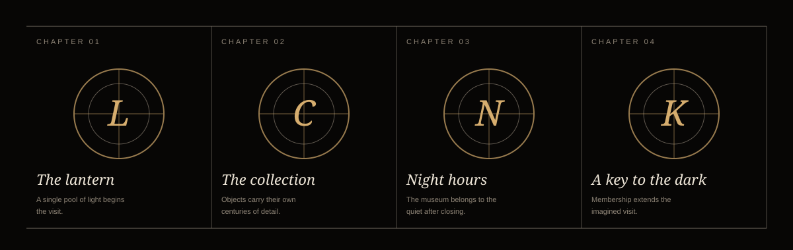
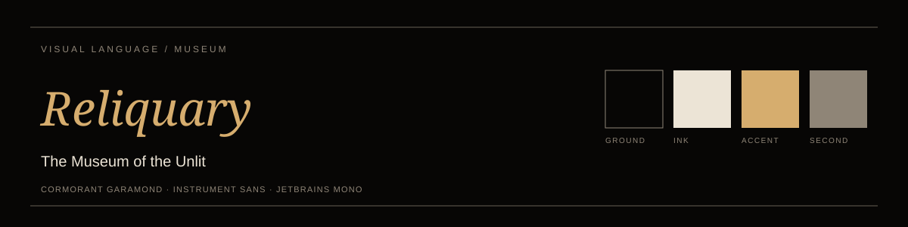
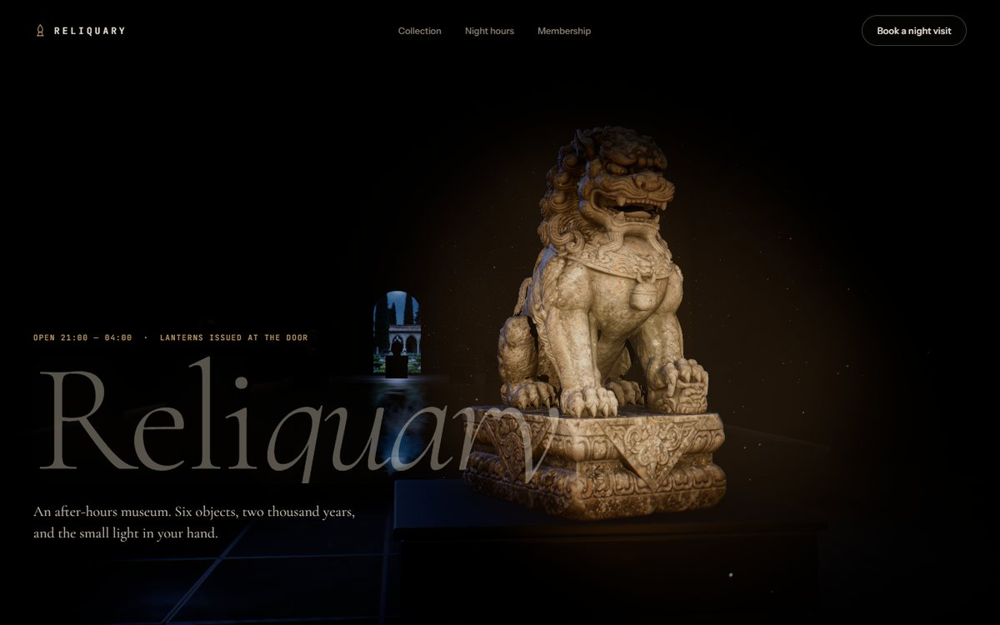

<p align="center"></p>

# Reliquary

*The Museum of the Unlit*

An after-hours museum imagined around six objects, two thousand years, and the small light placed in each visitor’s hand. The site asks what changes when a collection is encountered without the usual flood of gallery light.

The project is live at `https://reliquary.aarya.cyou/`. The site is an interactive concept; its booking, purchase, or application invitations do not complete real transactions.

## The idea

This project treats museum as an atmosphere to enter. Its selected scenes move from **The lantern** to **A key to the dark**, giving the central subject several different scales and moods. The result is a designed world rather than a catalogue of screens.

<p align="center"></p>

## Four scenes

| No. | Scene | Place in the story |
| --- | --- | --- |
| 1 | **The lantern** | A single pool of light begins the visit. |
| 2 | **The collection** | Objects carry their own centuries of detail. |
| 3 | **Night hours** | The museum belongs to the quiet after closing. |
| 4 | **A key to the dark** | Membership extends the imagined visit. |

These scenes are a selection from the full site. The page also contains supporting editorial sections and a closing invitation.

## Visual language

Black rooms, aged brass, restrained serif type, and long shadows make the object feel discovered rather than displayed.

The color plate below records the project's ground, ink, accent, and secondary tone. The type families in the design are Cormorant Garamond · Instrument Sans · JetBrains Mono.

<p align="center"></p>

## The site

The experience is built for the browser, with a visual scene that responds to the page and pointer. Its text remains arranged as a readable sequence of sections. The screenshot below shows the opening composition.

<p align="center"></p>

<p align="center"><sub>Opening scene captured from the original project.</sub></p>

## Built with

| Part | Tools |
| --- | --- |
| Site and build | JavaScript, Vite, Tailwind CSS, custom CSS |
| Three-dimensional scene | Three.js and project-specific shaders/models |
| Motion and scrolling | GSAP, ScrollTrigger, Lenis |
| Hosting configuration | Cloudflare Pages, `wrangler.jsonc` |

The site is one project at the repository root. The current application is in `src/`; render, asset, input, scroll, and UI utilities are in `src/core/`. Old collection material is preserved under `docs/archive/`.

## Run locally

Use Node.js 22.12 or newer:

```bash
npm ci
npm run dev
```

Vite serves the site at `http://127.0.0.1:5190/`. To build and preview the production output:

```bash
npm run build
npm run preview
```

The build writes to `dist/`; preview serves it at `http://127.0.0.1:5191/`.

## Deployment

For Cloudflare Pages, connect the repository's `main` branch. Use `npm run build` as the build command, `dist` as the output directory, and the repository root as the root directory. The React (Vite) preset supplies the build values; `wrangler.jsonc` also records the Pages output directory. The live site is `https://reliquary.aarya.cyou/`; pushes to `main` deploy through the connected GitHub repository.

## Repository guide

| Path | Contents |
| --- | --- |
| `index.html` | Single site entry |
| `src/` | Scene, styles, shaders, and page modules |
| `src/core/` | Shared rendering and interaction utilities |
| `public/` | Project models and images |
| `docs/` | Project art, screenshot, credits, and notices |
| `docs/archive/` | Preserved earlier collection material |
| `wrangler.jsonc` | Cloudflare Pages output configuration |

## Rights and credits

The repository has separate rights scopes. Reuse rights for one part do not extend to the others:

| Material | Terms |
| --- | --- |
| Adapted source code | [MIT license](LICENSE), with the original copyright retained |
| New project SVGs and original presentation | [Reliquary content notice](LICENSE-RELIQUARY.md) |
| Zyrix Dev name and marks, where referenced | [Zyrix Dev brand notice](LICENSE-ZYRIXDEV.md) |
| Models, source images, and the screenshot | [Asset licenses](docs/ASSET-LICENSES.md) |
| Libraries and web fonts | [Third-party notices](docs/THIRD-PARTY-NOTICES.md) |

The source project and contributors are acknowledged in [Credits](docs/CREDITS.md). The original source copyright remains in [LICENSE](LICENSE).
